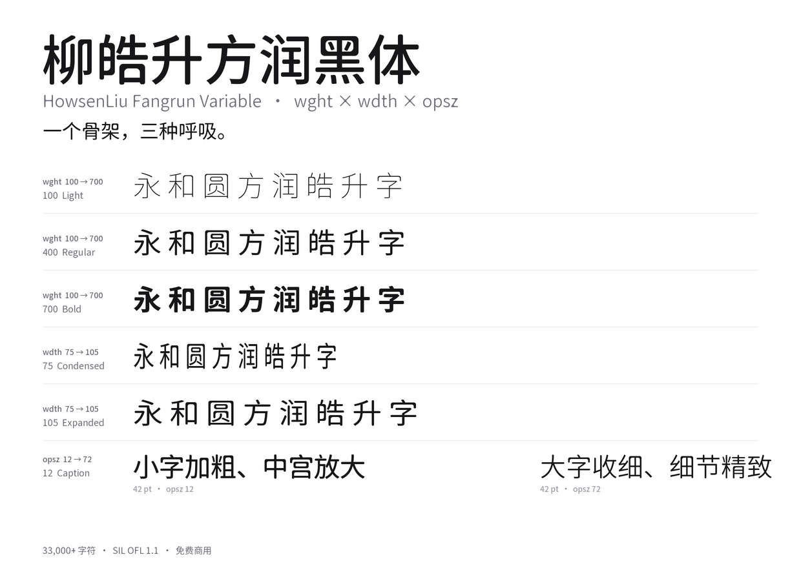
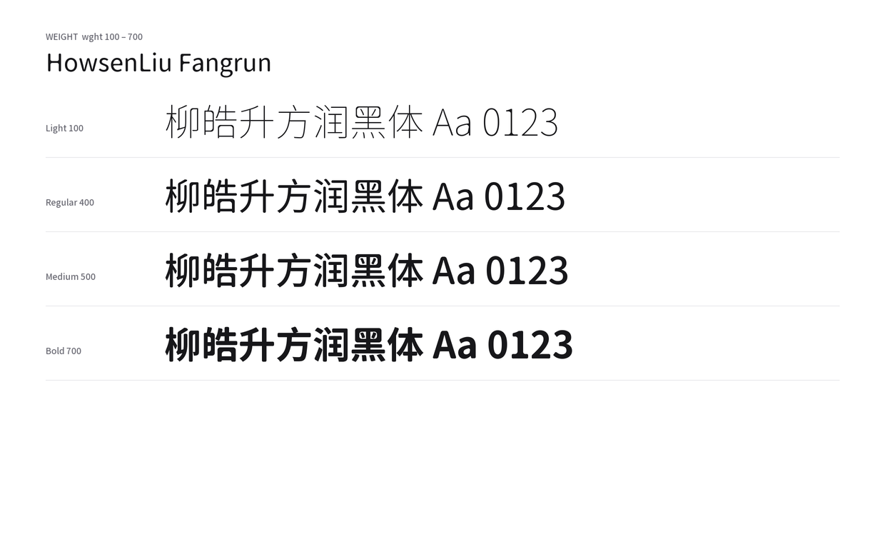
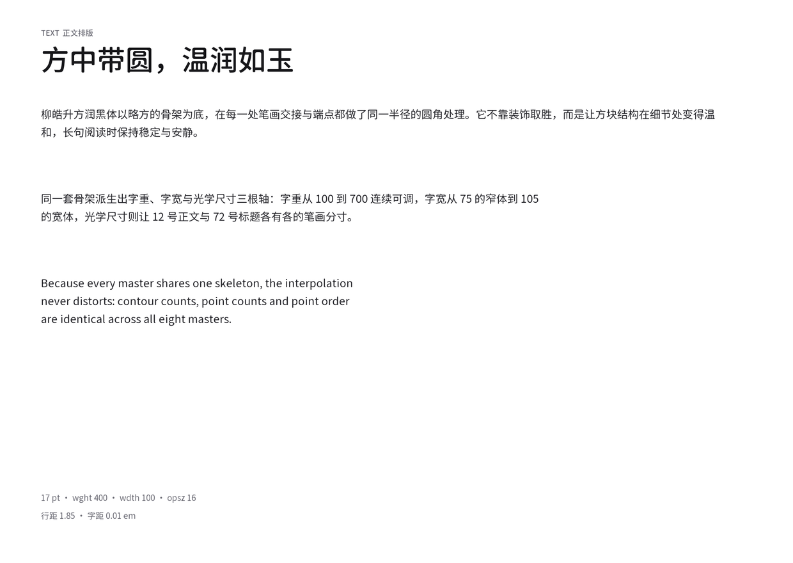
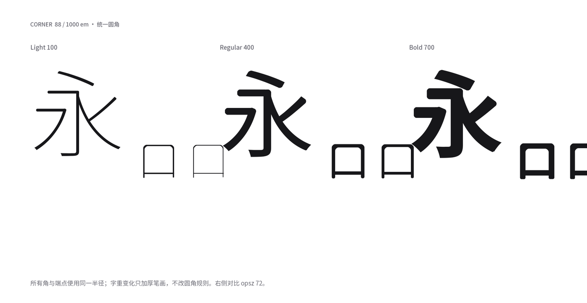

<div align="center">

# HowsenLiu Fangrun · 柳皓升方润黑体

**A rounded-square CJK sans — square in structure, soft at the terminals, built for screen and print.**

[](https://github.com/HowsenLiu/HowsenLiuFangrun/releases/latest)
[](LICENSE)
[](#overview)

[简体中文](README.zh-CN.md) · [Website](https://howsenliufangrun.pages.dev) · [GitHub](https://github.com/HowsenLiu/HowsenLiuFangrun)

</div>


<table>
<tr>
<td width="62%" valign="top">

## Overview

**HowsenLiu Fangrun (柳皓升方润黑体)** sits on an architectural, slightly square
skeleton; every stroke corner and terminal is softened with one consistent fillet
radius. The result reads clean in body text and stays confident at display sizes.

Designed by **Howsen Liu (柳皓升)**.

## Features

- **Unified rounding** — every corner and terminal shares the same fillet radius, for one consistent voice.
- **Wide coverage** — 33,128 glyphs / 33,225 code points: GBK, GB18030 Level-1, Big5 traditional, kana, bopomofo, Latin, Greek, Cyrillic and common symbols.
- **Multiple weights** — variable weight 100–700, plus four static weights (Light / Regular / Medium / Bold) and web WOFF2 builds.
- **Free to use** — free for both personal and commercial projects.

## Install

**Windows** — select the `.ttf` files → right-click → *Install*.
**macOS** — double-click the font file → *Install Font*.
**Linux**

```bash
mkdir -p ~/.local/share/fonts
cp fonts/ttf/*.ttf ~/.local/share/fonts
fc-cache -f -v
```

For older WPS or legacy software that ignores variable axes, download the TTC
collection from the Release to get all four static weights in one file.

## Web usage

```css
@font-face {
  font-family: "HowsenLiu Fangrun";
  src: url("fonts/webfonts/HowsenLiuFangrun-VF-subset.woff2") format("woff2");
  font-weight: 100 700;
  font-display: swap;
}

body { font-family: "HowsenLiu Fangrun", sans-serif; }
```

The full-charset WOFF2 is large and ships as a Release asset; for live pages use
the GB2312 common subset in this repo, or subset further to your own copy.

## License

- **Allowed** — personal and commercial use, embedding in web pages, documents, packaging, interfaces and shipped products.
- **Prohibited** — modifying the font files or technical parameters, extracting outlines to build derivative fonts, redistributing or reselling the files on their own, or training AI models with them. Only the author may modify the source and font files.
- Full terms: [LICENSE](LICENSE). Original skeleton attribution (Noto / Adobe) is retained as required.

</td>
<td width="38%" valign="top">

### ⬇️ Downloads

| Release | Format · Size | Download |
|---|---|---|
| Variable font | `.ttf` · 140.0 MB | [Get](https://github.com/HowsenLiu/HowsenLiuFangrun/releases/latest/download/HowsenLiuFangrun-VF.ttf) |
| Static weights | `.zip` · 47.7 MB | [Get](https://github.com/HowsenLiu/HowsenLiuFangrun/releases/latest/download/HowsenLiuFangrun-Static-TTF.zip) |
| TTC collection | `.ttc` · 114.5 MB | [Get](https://github.com/HowsenLiu/HowsenLiuFangrun/releases/latest/download/HowsenLiuFangrun-TTC.ttc) |
| Web fonts | `.zip` · 65.7 MB | [Get](https://github.com/HowsenLiu/HowsenLiuFangrun/releases/latest/download/HowsenLiuFangrun-WOFF2.zip) |
| Variable package | `.zip` · 124.2 MB | [Get](https://github.com/HowsenLiu/HowsenLiuFangrun/releases/latest/download/HowsenLiuFangrun-VF.zip) |
| TTC package | `.zip` · 47.2 MB | [Get](https://github.com/HowsenLiu/HowsenLiuFangrun/releases/latest/download/HowsenLiuFangrun-TTC.zip) |

### 🌐 Website

- [Font website](https://howsenliufangrun.pages.dev)
- [Author on GitHub](https://github.com/HowsenLiu)
- [X / Twitter](https://x.com/HowsenLiu_)

</td>
</tr>
</table>

## Specimens

<p align="center">


</p>
<p align="center">


</p>

---

<div align="center">

Designed by **Howsen Liu** · Version 2.000 · [Changelog](CHANGELOG.md)

</div>
