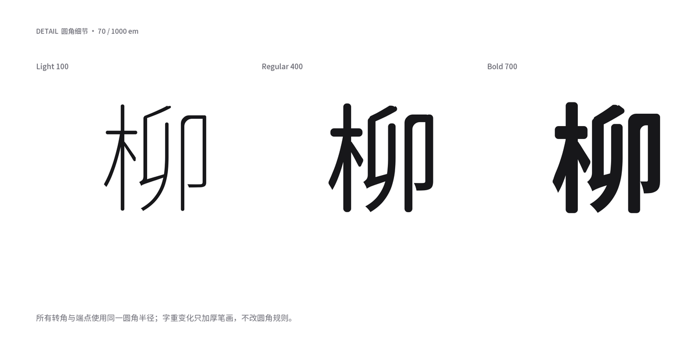

<div align="center">

<picture>
  <source media="(prefers-color-scheme: dark)" srcset="logo-mark-dark.png">
  
</picture>

# HowsenLiu Fangrun · 柳皓升方润黑体

**A rounded-square CJK sans — square in structure, soft at the terminals, built for screen and print.**

[](https://github.com/HowsenLiu/HowsenLiuFangrun/releases/latest)
[](LICENSE)
[](#character-support)

[简体中文](README.zh-CN.md) · [Website](https://howsenliufangrun.pages.dev) · [GitHub](https://github.com/HowsenLiu/HowsenLiuFangrun)

<picture>
  <source media="(prefers-color-scheme: dark)" srcset="specimen/hero-dark.gif">
  
</picture>

</div>

HowsenLiu Fangrun is a sans-serif that balances an architectural, slightly square skeleton with
consistent rounded terminals. Every corner and stroke ending shares one fillet radius, so the
typeface reads clean in long lines and stays confident at display sizes. It covers Simplified and
Traditional Chinese, Latin and European accented letters, Greek, Cyrillic, Japanese kana,
bopomofo, Arabic numerals and common punctuation and symbols.

## Download & Install

- Go to [Releases](https://github.com/HowsenLiu/HowsenLiuFangrun/releases/latest) to download the
  installation packages:
  - `.ttf` and `.ttc` files install on the desktop — open the file and follow the system prompt;
  - `.woff2` is the web font format for web developers.
- Install by platform:
  - **Windows** — select the `.ttf` files → right-click → *Install*.
  - **macOS** — double-click the font file → *Install Font*.
  - **Linux**

    ```bash
    mkdir -p ~/.local/share/fonts
    cp fonts/ttf/*.ttf ~/.local/share/fonts
    fc-cache -f -v
    ```
- For older WPS or legacy software that ignores variable axes, download the TTC collection, which
  carries all four static weights in one file.

### Release assets

| Release | Format · Size | Download |
|---|---|---|
| Variable font | `.ttf` · 140.0 MB | [Get](https://github.com/HowsenLiu/HowsenLiuFangrun/releases/latest/download/HowsenLiuFangrun-VF.ttf) |
| Static weights | `.zip` · 47.7 MB | [Get](https://github.com/HowsenLiu/HowsenLiuFangrun/releases/latest/download/HowsenLiuFangrun-Static-TTF.zip) |
| TTC collection | `.ttc` · 114.5 MB | [Get](https://github.com/HowsenLiu/HowsenLiuFangrun/releases/latest/download/HowsenLiuFangrun-TTC.ttc) |
| Web fonts | `.zip` · 65.7 MB | [Get](https://github.com/HowsenLiu/HowsenLiuFangrun/releases/latest/download/HowsenLiuFangrun-WOFF2.zip) |
| Variable package | `.zip` · 124.2 MB | [Get](https://github.com/HowsenLiu/HowsenLiuFangrun/releases/latest/download/HowsenLiuFangrun-VF.zip) |
| TTC package | `.zip` · 47.2 MB | [Get](https://github.com/HowsenLiu/HowsenLiuFangrun/releases/latest/download/HowsenLiuFangrun-TTC.zip) |

### Prompt for AI assistants

One tailored prompt per package — paste the one you need into your AI assistant; the direct download link is included.

**Variable pack (VF)**

```text
Fetch the "HowsenLiu Fangrun" variable font pack from GitHub and install it in my project.
Direct download: https://github.com/HowsenLiu/HowsenLiuFangrun/releases/latest/download/HowsenLiuFangrun-VF.zip
Repo: https://github.com/HowsenLiu/HowsenLiuFangrun
The pack contains HowsenLiuFangrun-VF.ttf, with axes wght 100–700, wdth 75–105 and opsz 12–72.
Use it under the repository LICENSE (SIL OFL 1.1): free for commercial use; modification and derivatives are allowed, but derivatives must remain under OFL 1.1 with attribution and license text retained; the font files may not be sold standalone.
```

**Static TTF pack**

```text
Fetch the "HowsenLiu Fangrun" static TTF pack from GitHub and install it in my project.
Direct download: https://github.com/HowsenLiu/HowsenLiuFangrun/releases/latest/download/HowsenLiuFangrun-Static-TTF.zip
Repo: https://github.com/HowsenLiu/HowsenLiuFangrun
The pack carries four static weights: Light / Regular / Medium / Bold.
Use it under the repository LICENSE (SIL OFL 1.1): free for commercial use; modification and derivatives are allowed, but derivatives must remain under OFL 1.1 with attribution and license text retained; the font files may not be sold standalone.
```

**TTC collection**

```text
Fetch the "HowsenLiu Fangrun" TTC collection from GitHub and install it in my project (for legacy WPS and older systems).
Direct download: https://github.com/HowsenLiu/HowsenLiuFangrun/releases/latest/download/HowsenLiuFangrun-TTC.zip
Repo: https://github.com/HowsenLiu/HowsenLiuFangrun
Single-file TTC collection with all four static weights.
Use it under the repository LICENSE (SIL OFL 1.1): free for commercial use; modification and derivatives are allowed, but derivatives must remain under OFL 1.1 with attribution and license text retained; the font files may not be sold standalone.
```

**Web WOFF2 pack**

```text
Fetch the "HowsenLiu Fangrun" web WOFF2 pack from GitHub and embed it in my website.
Direct download: https://github.com/HowsenLiu/HowsenLiuFangrun/releases/latest/download/HowsenLiuFangrun-WOFF2.zip
Repo: https://github.com/HowsenLiu/HowsenLiuFangrun
Compressed WOFF2 builds for web embedding.
Use it under the repository LICENSE (SIL OFL 1.1): free for commercial use; modification and derivatives are allowed, but derivatives must remain under OFL 1.1 with attribution and license text retained; the font files may not be sold standalone.
```

## Character support

| Script | Coverage |
|:-:|:-:|
| Han characters | GBK full set, GB18030 Level 1, Big5 Traditional; 33,128 glyphs / 33,225 code points in total |
| Latin & European | Basic Latin plus accented letters (À Á Â Ä Ç É È Ê Ë Ñ Ó Ô Ö Ú Ü ã õ ç …), covering English, French, German, Spanish, Portuguese and more |
| Greek & Cyrillic | Basic Greek and Cyrillic alphabets |
| Japanese kana | Hiragana and katakana |
| Bopomofo | Mandarin phonetic symbols ㄅㄆㄇㄈ |
| Numerals | Arabic numerals 0–9 and Roman numerals Ⅰ–Ⅹ |
| Punctuation & symbols | CJK and Western punctuation, arrows, geometric shapes, currency marks and common symbols |

## Variable axes

| Axis | Range · Default |
|:-:|:-:|
| `wght` — weight | 100–700 · 400 |
| `wdth` — width | 75–105 · 100 |
| `opsz` — optical size | 12–72 · 16 |

Static companions for software without variable-axis support: Light / Regular / Medium / Bold four
TTFs and a TTC collection.

## Notes

- Simplified / Traditional regional variants are not separated (no `locl` feature).
- No TrueType hinting; no Latin kerning (`kern` / GPOS pairs).
- The width axis is a proportional horizontal scale; stems get proportionally lighter at 75.

## Specimens





## Web usage

```css
@font-face {
  font-family: "HowsenLiu Fangrun";
  src: url("fonts/webfonts/HowsenLiuFangrun-VF-subset.woff2") format("woff2");
  font-weight: 100 700;
  font-display: swap;
}

body { font-family: "HowsenLiu Fangrun", sans-serif; }
```

The full-charset WOFF2 is large and ships as a Release asset; for live pages use the GB2312
common subset in this repo, or subset further to your own copy.

## About

- Design: [Howsen Liu (柳皓升)](https://github.com/HowsenLiu)
- Website: [howsenliufangrun.pages.dev](https://howsenliufangrun.pages.dev)
- X / Twitter: [@HowsenLiu_](https://x.com/HowsenLiu_)
- Code of Conduct: [`.github/CODE_OF_CONDUCT.md`](.github/CODE_OF_CONDUCT.md)

## License

- Released under the **SIL Open Font License 1.1 (OFL 1.1)** — free for personal and commercial
  use, embeddable in web pages, documents, packaging, interfaces and shipped products; modification
  and derivative fonts are permitted.
- Derivatives must remain under OFL 1.1 and retain the copyright notices and license text; the
  font files may not be sold standalone.
- **Reserved Font Names**: `HowsenLiu Fangrun`, `柳皓升方润黑体`, `方润黑体`, `Fangrun` —
  modified derivatives must be renamed before release and may not keep any of these names.
- Full terms: [LICENSE](LICENSE). Original skeleton attribution retained: Noto Sans CJK SC / Noto
  Sans SC (Copyright 2014–2021 Adobe and Google LLC, SIL OFL 1.1); rounding, weight pairing and
  naming by Howsen Liu.

---

<div align="center">

Copyright © 2026 **Howsen Liu** · Version 2.000 · [Changelog](CHANGELOG.md)

</div>
