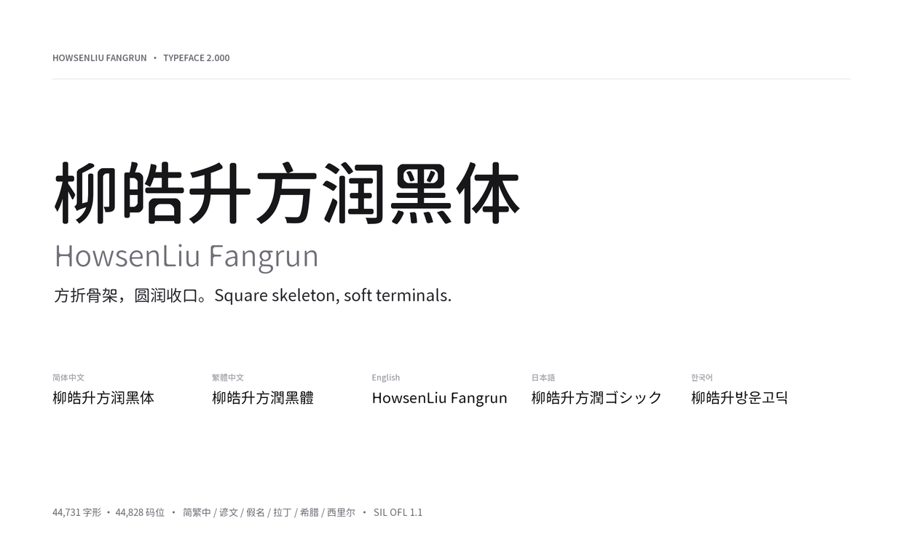
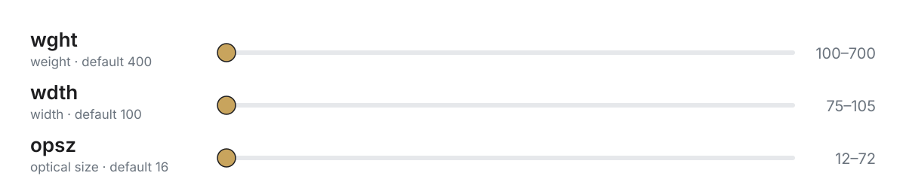
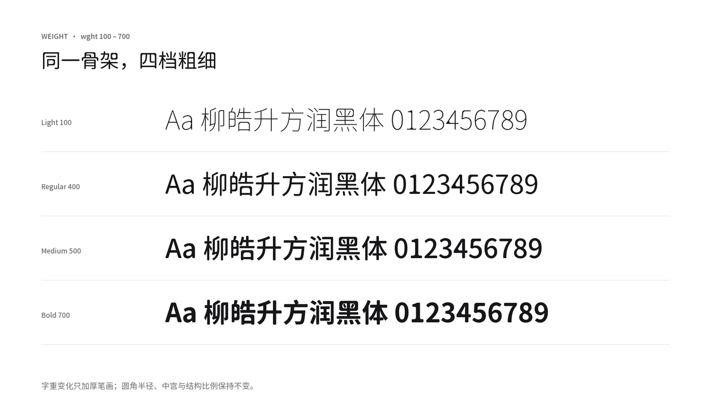

<div align="center">

<picture>
  <source media="(prefers-color-scheme: dark)" srcset="logo-mark-dark.png">
  
</picture>

# HowsenLiu Fangrun · 柳皓升方润黑体

**A rounded-square CJK sans — square in structure, soft at the terminals, built for screen and print.**

**柳皓升方润黑体 · 柳皓升方潤黑體 · HowsenLiu Fangrun · 柳皓升方潤ゴシック · 柳皓升방운고딕**

[](https://github.com/HowsenLiu/HowsenLiuFangrun/releases/latest)
[](LICENSE)
[](#character-support)

[](README.zh-CN.md)
[](https://github.com/HowsenLiu/HowsenLiuFangrun)
[](https://howsenliufangrun.pages.dev/)


<picture>
  <source media="(prefers-color-scheme: dark)" srcset="specimen/hero-dark.png">
  
</picture>


</div>

HowsenLiu Fangrun is a sans-serif that balances an architectural, slightly square skeleton with
consistent rounded terminals. Every corner and stroke ending shares one fillet radius, so the
typeface reads clean in long lines and stays confident at display sizes. It covers Simplified and
Traditional Chinese, Korean Hangul (all precomposed syllables and jamo), Latin and European
accented letters, Greek, Cyrillic, Japanese kana, bopomofo, superscript / subscript / modifier
letters, Arabic numerals and common punctuation and symbols — **44,731 glyphs across 44,828 code
points** in total.

## Download & Install

- Go to [Releases](https://github.com/HowsenLiu/HowsenLiuFangrun/releases/latest) to download the
  installation packages:
  - `.ttf` and `.ttc` files install on the desktop — open the file and follow the system prompt;
  - `.woff2` is the web font format for web developers.
- Install by platform:
  - **Windows** — select the `.ttf` files → right-click → *Install*.
  - **macOS** — double-click the font file → *Install Font*.
  - **Linux**

    ```bash
    mkdir -p ~/.local/share/fonts
    cp fonts/ttf/*.ttf ~/.local/share/fonts
    fc-cache -f -v
    ```
- For older WPS or legacy software that ignores variable axes, download the TTC collection, which
  carries all four static weights in one file.
- The variable, static and TTC builds use independent family names and PostScript names, so all
  three can be installed together without the font manager treating them as duplicates.

### Release assets

All packages are free to download under the repository OFL 1.1 license.

- **Container bundle (GitHub Packages)** — [`ghcr.io/howsenliu/howsenliu-fangrun`](https://github.com/HowsenLiu/HowsenLiuFangrun/pkgs/container/howsenliu-fangrun), tags `latest` / `2.000`; mirrors the Release assets above with the OFL license included.

| Category | Pack | File | Format · Size | Download |
|---|---|---|---|---|
| Desktop | Variable font | `HowsenLiuFangrun-VF.ttf` | TTF · 184.1 MB | [Get](https://github.com/HowsenLiu/HowsenLiuFangrun/releases/latest/download/HowsenLiuFangrun-VF.ttf) |
| Desktop | Variable package · VF + full WOFF2 + FONTLOG | `HowsenLiuFangrun-VF.zip` | ZIP · 151.4 MB | [Get](https://github.com/HowsenLiu/HowsenLiuFangrun/releases/latest/download/HowsenLiuFangrun-VF.zip) |
| Desktop | Static weights · Light / Regular / Medium / Bold | `HowsenLiuFangrun-Static-TTF.zip` | ZIP · 56.5 MB | [Get](https://github.com/HowsenLiu/HowsenLiuFangrun/releases/latest/download/HowsenLiuFangrun-Static-TTF.zip) |
| Desktop | TTC collection · four static weights in one file | `HowsenLiuFangrun-TTC.ttc` | TTC · 150.4 MB | [Get](https://github.com/HowsenLiu/HowsenLiuFangrun/releases/latest/download/HowsenLiuFangrun-TTC.ttc) |
| Desktop | TTC package | `HowsenLiuFangrun-TTC.zip` | ZIP · 55.9 MB | [Get](https://github.com/HowsenLiu/HowsenLiuFangrun/releases/latest/download/HowsenLiuFangrun-TTC.zip) |
| Web embedding | Web font pack · full / subset / demo WOFF2 | `HowsenLiuFangrun-WOFF2.zip` | ZIP · 80.2 MB | [Get](https://github.com/HowsenLiu/HowsenLiuFangrun/releases/latest/download/HowsenLiuFangrun-WOFF2.zip) |
| License | OFL 1.1 full license text (also inside every pack) | `LICENSE-OFL-1.1.txt` | TXT · 4.5 KB | [Get](https://github.com/HowsenLiu/HowsenLiuFangrun/releases/latest/download/LICENSE-OFL-1.1.txt) |

### Prompt for AI assistants

One tailored prompt per package — paste the one you need into your AI assistant; the direct download link is included.

<details>
<summary><b>Variable pack (VF)</b></summary>

```text
Fetch the "HowsenLiu Fangrun" variable font pack from GitHub and install it in my project.
Direct download: https://github.com/HowsenLiu/HowsenLiuFangrun/releases/latest/download/HowsenLiuFangrun-VF.zip
Repo: https://github.com/HowsenLiu/HowsenLiuFangrun
The pack contains HowsenLiuFangrun-VF.ttf, with axes wght 100–700, wdth 75–105 and opsz 12–72.
Use it under the repository LICENSE (SIL OFL 1.1): free for commercial use; modification and derivatives are allowed, but derivatives must remain under OFL 1.1 with attribution and license text retained; the font files may not be sold standalone.
```

</details>

<details>
<summary><b>Static TTF pack</b></summary>

```text
Fetch the "HowsenLiu Fangrun" static TTF pack from GitHub and install it in my project.
Direct download: https://github.com/HowsenLiu/HowsenLiuFangrun/releases/latest/download/HowsenLiuFangrun-Static-TTF.zip
Repo: https://github.com/HowsenLiu/HowsenLiuFangrun
The pack carries four static weights: Light / Regular / Medium / Bold.
Use it under the repository LICENSE (SIL OFL 1.1): free for commercial use; modification and derivatives are allowed, but derivatives must remain under OFL 1.1 with attribution and license text retained; the font files may not be sold standalone.
```

</details>

<details>
<summary><b>TTC collection</b></summary>

```text
Fetch the "HowsenLiu Fangrun" TTC collection from GitHub and install it in my project (for legacy WPS and older systems).
Direct download: https://github.com/HowsenLiu/HowsenLiuFangrun/releases/latest/download/HowsenLiuFangrun-TTC.zip
Repo: https://github.com/HowsenLiu/HowsenLiuFangrun
Single-file TTC collection with all four static weights.
Use it under the repository LICENSE (SIL OFL 1.1): free for commercial use; modification and derivatives are allowed, but derivatives must remain under OFL 1.1 with attribution and license text retained; the font files may not be sold standalone.
```

</details>

<details>
<summary><b>Web WOFF2 pack</b></summary>

```text
Fetch the "HowsenLiu Fangrun" web WOFF2 pack from GitHub and embed it in my website.
Direct download: https://github.com/HowsenLiu/HowsenLiuFangrun/releases/latest/download/HowsenLiuFangrun-WOFF2.zip
Repo: https://github.com/HowsenLiu/HowsenLiuFangrun
Compressed WOFF2 builds for web embedding.
Use it under the repository LICENSE (SIL OFL 1.1): free for commercial use; modification and derivatives are allowed, but derivatives must remain under OFL 1.1 with attribution and license text retained; the font files may not be sold standalone.
```

</details>

## Character support

| Script / Block | Coverage |
|---|---|
| Han — Simplified & Traditional | GBK full set, GB 18030 Level 1/2, Big5 Traditional; 20,976 unified CJK ideographs plus 6,582 CJK Ext-A glyphs |
| Korean Hangul | All 11,172 precomposed syllables (가–힣), 254 jamo, extended jamo A/B, compatibility letters and halfwidth forms |
| Japanese kana | 93 hiragana, 96 katakana |
| Latin & European | Basic Latin plus Latin Extended-A/Additional and diacritics (À Á Â Ä Ç É È Ê Ë Ñ Ó Ô Ö Ú Ü ã õ ç …), covering English, French, German, Spanish, Portuguese, Italian and more |
| Greek & Cyrillic | Basic Greek alphabet (49 codepoints) and Cyrillic alphabet (66 codepoints) |
| Bopomofo | 43 Mandarin phonetic symbols ㄅㄆㄇㄈ |
| Numerals & letter marks | Arabic numerals 0–9, Roman numerals Ⅰ–Ⅹ, superscript / subscript / modifier letters |
| Punctuation & symbols | CJK and Western punctuation, arrows, geometric shapes, currency marks, copyright / trademark signs and common UI symbols |
| **Total** | **44,731 glyphs / 44,828 code points** |

## Variable axes



| Axis | Range · Default |
|:-:|:-:|
| `wght` — weight | 100–700 · 400 |
| `wdth` — width | 75–105 · 100 |
| `opsz` — optical size | 12–72 · 16 |

Static companions for software without variable-axis support: Light / Regular / Medium / Bold four
TTFs and a TTC collection.

## OpenType features

The variable font and the four static companions ship the same GSUB / GPOS feature set.

### Substitution (GSUB)

| Feature | Tag | Role |
|---|---|---|
| Standard ligatures | `liga` | Default ligatures |
| Discretionary ligatures | `dlig` | Optional ligatures |
| Glyph composition / decomposition | `ccmp` | Combine or decompose composite characters |
| Localized forms | `locl` | Script-specific localized variants |
| Full-width alternates | `fwid` | Full-width glyph substitutions |
| Half-width alternates | `hwid` | Half-width glyph substitutions |
| Proportional-width alternates | `pwid` | Proportional-width substitutions |
| Vertical alternates | `vert` / `vrt2` | Upright alternates for vertical typesetting |
| Ruby alternates | `ruby` | Small-letter forms for ruby (furigana) |
| Historical forms | `hist` | Legacy / historical glyph forms |
| Alternate access | `aalt` | Expose all alternates for a glyph |

### Positioning (GPOS)

| Feature | Tag | Role |
|---|---|---|
| Horizontal kerning | `kern` | Pair kerning for kana, CJK punctuation and Latin diacritic marks (845 pairs) |
| Vertical kerning | `vkrn` | Pair kerning in vertical writing (560 pairs) |
| Mark positioning | `mark` | Mark-to-base and mark-to-mark attachment |
| Vertical positioning | `vert` | Positioning for vertical writing |
| Width-aware positioning | `halt` `palt` `vhal` `vpal` | Half-width / proportional positioning tables; registered tags without extra adjustment rules in this build |

### Tables

- `fvar` / `STAT` / `gvar` / `HVAR` / `VVAR` — variable axes and variation metadata
- `cmap` — Unicode mapping (format 4 + format 12), `BASE`, `GDEF`, `hmtx`, `vmtx`, `gasp`
- No Apple AAT tables (`mort` / `morx`).

## Notes

- Simplified / Traditional regional variants are not split through `locl` beyond the retained localized forms.
- No TrueType hinting; Latin base-letter pairs are not specially kerned — retained `kern` / `vkrn` pairs cover kana, CJK punctuation and diacritic marks.
- The width axis is a proportional horizontal scale; stems get proportionally lighter at 75.

## Specimens


<picture>
  <source media="(prefers-color-scheme: dark)" srcset="specimen/hero-dark.png">
  
</picture>

<picture>
  <source media="(prefers-color-scheme: dark)" srcset="specimen/spec-weights-dark.png">
  
</picture>

<picture>
  <source media="(prefers-color-scheme: dark)" srcset="specimen/spec-multilingual-dark.png">
  
</picture>

<picture>
  <source media="(prefers-color-scheme: dark)" srcset="specimen/spec-text-dark.png">
  
</picture>

<picture>
  <source media="(prefers-color-scheme: dark)" srcset="specimen/spec-charset-dark.png">
  
</picture>

## Web usage

```css
@font-face {
  font-family: "HowsenLiu Fangrun";
  src: url("fonts/webfonts/HowsenLiuFangrun-VF-subset.woff2") format("woff2");
  font-weight: 100 700;
  font-display: swap;
}

body { font-family: "HowsenLiu Fangrun", sans-serif; }
```

The full-charset WOFF2 is large and ships as a Release asset; for live pages use the GB2312
common subset in this repo, or subset further to your own copy.

## About


- Design: [Howsen Liu (柳皓升)](https://github.com/HowsenLiu)
- Website: [howsenliufangrun.pages.dev](https://howsenliufangrun.pages.dev/)
- X / Twitter: [@HowsenLiu_](https://x.com/HowsenLiu_)
- Code of Conduct: [`.github/CODE_OF_CONDUCT.md`](.github/CODE_OF_CONDUCT.md)

## License

This repository ships under **two SIL Open Font License 1.1 (OFL 1.1)** texts:

1. **This release** — [`LICENSE`](LICENSE): Copyright 2014–2021 Adobe and Google LLC
   (Noto Sans CJK SC / Noto Sans SC / Noto Sans KR); Copyright 2026 柳皓升 Howsen Liu
   (https://github.com/HowsenLiu). Released under OFL 1.1.
2. **Upstream retained source** — [`sources/kr/OFL-NotoSansKR.txt`](sources/kr/OFL-NotoSansKR.txt):
   the verbatim OFL 1.1 notice for the embedded Noto Sans KR skeleton source, Copyright
   2014–2021 Adobe, Reserved Font Name `Source`.

Usage follows the OFL 1.1 text: free for personal and commercial use; glyphs may be modified and
derivative fonts may be created. Derivatives must remain under OFL 1.1 — they may not be relicensed
under any other license — and must retain the original copyright notices, author attribution and
the full license text. The font files may not be sold standalone.

- **Reserved Font Names**: `HowsenLiu Fangrun`, `柳皓升方润黑体`, `方润黑体`, `Fangrun` —
  modified derivatives must be renamed before release and may not keep any of these names.

### Usage scenarios

| Scenario | Details |
|:-:|---|
| ✅ Allowed (no extra license) | Print (posters, packaging, brochures), video subtitles and covers, web font loading, personal and commercial brand materials, design deliverables |
| ✅ Redistributable (keep attribution and full OFL text) | Bundling with software, projects or hardware |
| ⚠️ Written confirmation recommended | Embedding inside App / mini-program / game install packages; registering trademarks built primarily on the glyph shapes |
| ❌ Prohibited | Selling the font files standalone as a package; removing or altering the original copyright notices and license text |

---

<div align="center">

Copyright © 2026 **Howsen Liu** · Version 2.000 · [Changelog](CHANGELOG.md)

</div>
