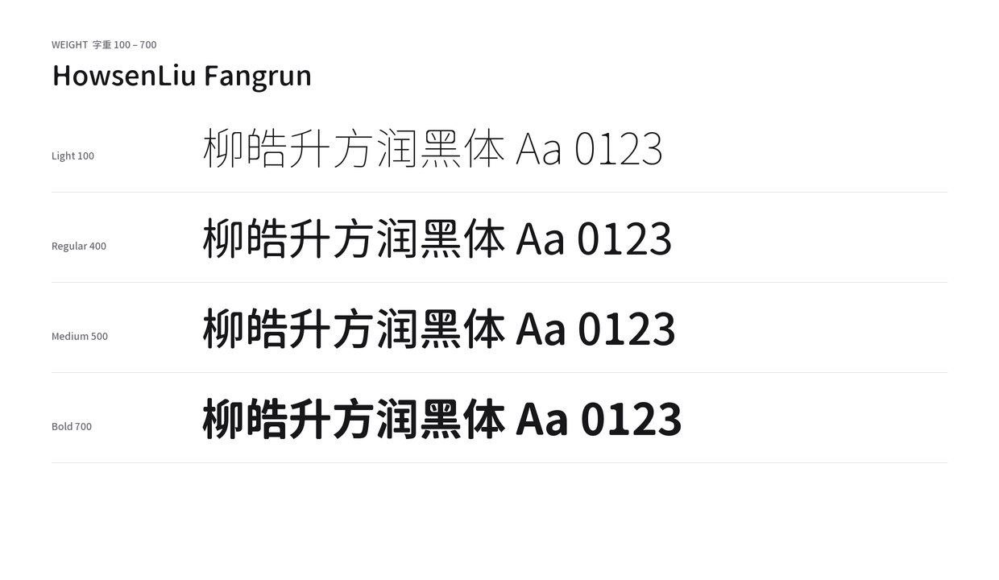
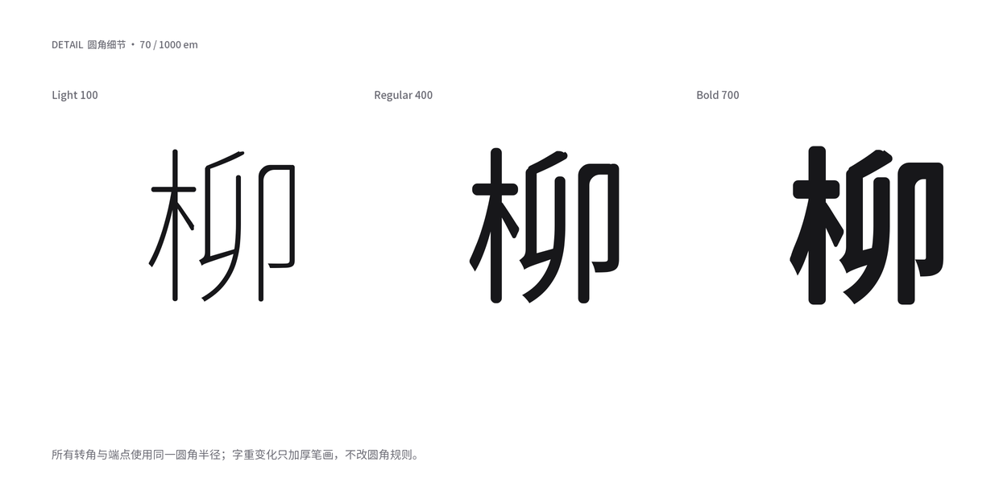
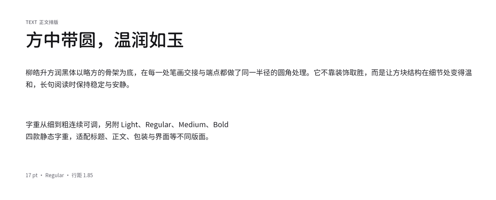
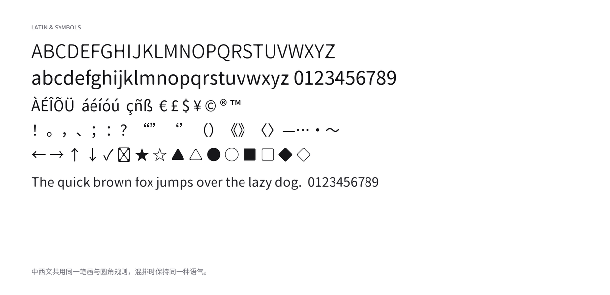

<div align="center">

<a href="#gh-light-mode-only">
  
</a>
<a href="#gh-dark-mode-only">
  
</a>

# 柳皓升方润黑体 · HowsenLiu Fangrun

**方折骨架，圆润收口 —— 一款为屏幕与印刷打磨的中文无衬线字体。**

[](https://github.com/HowsenLiu/HowsenLiuFangrun/releases/latest)
[](LICENSE)
[](#字符支持)

[English](README.md) · [字体官网](https://howsenliufangrun.pages.dev) · [GitHub](https://github.com/HowsenLiu/HowsenLiuFangrun)

<a href="#gh-light-mode-only">
  
</a>
<a href="#gh-dark-mode-only">
  
</a>

</div>

柳皓升方润黑体是一款在人文观感与几何骨架之间取得平衡的中文无衬线字体。整体以略方的
建筑感骨架为底，在每一处笔画交接与端点做同一半径的圆角处理：结构方折，细节柔和，
长句阅读干净，标题醒目。字体覆盖简繁中文、拉丁及欧洲带调字母、希腊字母、西里尔字母、
日文假名、注音符号、阿拉伯数字与各类常用标点符号。

## 下载安装

- 点击 [Releases](https://github.com/HowsenLiu/HowsenLiuFangrun/releases/latest) 可直接下载
  安装文件包：
  - `.ttf` / `.ttc` 文件用于桌面端安装，打开文件后按系统提示安装即可；
  - `.woff2` 为网页字体格式，供网站开发人员使用。
- 按系统安装：
  - **Windows** — 选中 `.ttf` 文件 → 右键 → *安装*。
  - **macOS** — 双击字体文件 → *安装字体*。
  - **Linux**

    ```bash
    mkdir -p ~/.local/share/fonts
    cp fonts/ttf/*.ttf ~/.local/share/fonts
    fc-cache -f -v
    ```
- 不支持可变轴的旧版 WPS / 老软件，可下载 TTC 集合包，一次装入四款静态字重。
- 可变、静态、TTC 三套文件使用各自独立的族名与 PostScript 名，同时安装不会被字体管理器判为重复而互相覆盖。

### Release 附件

| 版本 | 格式 · 体积 | 下载 |
|---|---|---|
| 可变字体 | `.ttf` · 140.0 MB | [获取](https://github.com/HowsenLiu/HowsenLiuFangrun/releases/latest/download/HowsenLiuFangrun-VF.ttf) |
| 静态字重包 | `.zip` · 47.7 MB | [获取](https://github.com/HowsenLiu/HowsenLiuFangrun/releases/latest/download/HowsenLiuFangrun-Static-TTF.zip) |
| 静态集合包 | `.ttc` · 114.5 MB | [获取](https://github.com/HowsenLiu/HowsenLiuFangrun/releases/latest/download/HowsenLiuFangrun-TTC.ttc) |
| 网页字体包 | `.zip` · 54.9 MB | [获取](https://github.com/HowsenLiu/HowsenLiuFangrun/releases/latest/download/HowsenLiuFangrun-WOFF2.zip) |
| 可变完整包 | `.zip` · 124.2 MB | [获取](https://github.com/HowsenLiu/HowsenLiuFangrun/releases/latest/download/HowsenLiuFangrun-VF.zip) |
| 集合压缩包 | `.zip` · 47.2 MB | [获取](https://github.com/HowsenLiu/HowsenLiuFangrun/releases/latest/download/HowsenLiuFangrun-TTC.zip) |

### 给 AI 助手的自取提示词

每个安装包对应一段独立提示词，把需要的那段粘贴给 AI 助手即可，直达下载地址已写在其中。

**可变完整包（VF）**

```text
请从 GitHub 获取「柳皓升方润黑体 / HowsenLiu Fangrun」可变字体包，安装到我的项目。
直达下载：https://github.com/HowsenLiu/HowsenLiuFangrun/releases/latest/download/HowsenLiuFangrun-VF.zip
仓库：https://github.com/HowsenLiu/HowsenLiuFangrun
包内为可变字体 HowsenLiuFangrun-VF.ttf，含字重 wght 100–700、宽度 wdth 75–105、光学尺寸 opsz 12–72 三轴。
按仓库 LICENSE（SIL OFL 1.1）授权使用：可免费商用，也允许修改与制作衍生字体；衍生版本须继续以 OFL 1.1 发布，并保留署名与许可文本；字体文件不得脱离软件单独售卖。
```

**静态字重包（Static TTF）**

```text
请从 GitHub 获取「柳皓升方润黑体 / HowsenLiu Fangrun」静态字重包，安装到我的项目。
直达下载：https://github.com/HowsenLiu/HowsenLiuFangrun/releases/latest/download/HowsenLiuFangrun-Static-TTF.zip
仓库：https://github.com/HowsenLiu/HowsenLiuFangrun
包内含 Light / Regular / Medium / Bold 四款静态 TTF。
按仓库 LICENSE（SIL OFL 1.1）授权使用：可免费商用，也允许修改与制作衍生字体；衍生版本须继续以 OFL 1.1 发布，并保留署名与许可文本；字体文件不得脱离软件单独售卖。
```

**TTC 集合包**

```text
请从 GitHub 获取「柳皓升方润黑体 / HowsenLiu Fangrun」TTC 集合包，安装到我的项目（兼容旧版 WPS 与老系统）。
直达下载：https://github.com/HowsenLiu/HowsenLiuFangrun/releases/latest/download/HowsenLiuFangrun-TTC.zip
仓库：https://github.com/HowsenLiu/HowsenLiuFangrun
包内为单文件 TTC 集合，一次装入四款静态字重。
按仓库 LICENSE（SIL OFL 1.1）授权使用：可免费商用，也允许修改与制作衍生字体；衍生版本须继续以 OFL 1.1 发布，并保留署名与许可文本；字体文件不得脱离软件单独售卖。
```

**网页字体包（WOFF2）**

```text
请从 GitHub 获取「柳皓升方润黑体 / HowsenLiu Fangrun」网页 WOFF2 包，嵌入我的网站。
直达下载：https://github.com/HowsenLiu/HowsenLiuFangrun/releases/latest/download/HowsenLiuFangrun-WOFF2.zip
仓库：https://github.com/HowsenLiu/HowsenLiuFangrun
包内为网站嵌入用 WOFF2 压缩版本。
按仓库 LICENSE（SIL OFL 1.1）授权使用：可免费商用，也允许修改与制作衍生字体；衍生版本须继续以 OFL 1.1 发布，并保留署名与许可文本；字体文件不得脱离软件单独售卖。
```

## 字符支持

| 文字 | 支持情况 |
|:-:|:-:|
| 汉字 | 覆盖 GBK 全集、GB18030 一级、Big5 繁体；共计 33,128 字形 / 33,225 码位 |
| 拉丁与欧洲字母 | 基础拉丁 + 带变音字母（À Á Â Ä Ç É È Ê Ë Ñ Ó Ô Ö Ú Ü ã õ ç 等），可支持英、法、德、西、葡等语言 |
| 希腊 / 西里尔 | 基础希腊字母、西里尔字母 |
| 日文假名 | 平假名、片假名 |
| 注音符号 | 注音字母 ㄅㄆㄇㄈ |
| 数字 | 阿拉伯数字 0–9、罗马数字 Ⅰ–Ⅹ |
| 标点符号 | 中西文标点、箭头、几何形、货币符号与常用符号 |

## 可变轴

| 轴 | 范围 · 默认值 |
|:-:|:-:|
| `wght` 厚度 | 100–700 · 400 |
| `wdth` 宽窄 | 75–105 · 100 |
| `opsz` 光学尺寸 | 12–72 · 16 |

不支持可变轴的软件可使用配套静态字体：Light / Regular / Medium / Bold 四款 TTF 与
TTC 集合包。

## 注意事项

- 简繁区域变体未做区分（无 `locl` 特性）。
- 无 TrueType 屏幕提示（hinting）；无拉丁字距调整（`kern` / GPOS 配对）。
- 宽窄轴为等比例横向缩放，75 缩窄时笔画会成比例变细。

## 样张









## 网页嵌入

```css
@font-face {
  font-family: "HowsenLiu Fangrun";
  src: url("fonts/webfonts/HowsenLiuFangrun-VF-subset.woff2") format("woff2");
  font-weight: 100 700;
  font-display: swap;
}

body { font-family: "HowsenLiu Fangrun", sans-serif; }
```

全字符集 WOFF2 体积较大，随 Release 附件分发；线上页面建议使用仓库内的常用子集，
或按文案自行二次子集化。

## 关于

- 设计：[柳皓升（Howsen Liu）](https://github.com/HowsenLiu)
- 字体官网：[howsenliufangrun.pages.dev](https://howsenliufangrun.pages.dev)
- X / Twitter：[@HowsenLiu_](https://x.com/HowsenLiu_)
- 行为守则：[`.github/CODE_OF_CONDUCT.md`](.github/CODE_OF_CONDUCT.md)

## 许可证

- 本字体以 **SIL Open Font License 1.1（OFL 1.1）** 发布，使用边界遵循 OFL 1.1 协议原文：
  可免费用于个人与商业项目，允许修改字形、调整参数与制作衍生字体。
- 衍生版本必须继续以 OFL 1.1 发布，不得更换为其他许可证，并须保留原始版权声明
  （Adobe / Google LLC，Noto Sans CJK SC / Noto Sans SC）、作者署名与许可全文；字体文件
  不得脱离软件单独售卖。
- **保留字体名**：`HowsenLiu Fangrun`、`柳皓升方润黑体`、`方润黑体`、`Fangrun`；衍生修改版不得沿用以上任何名称，需更名后再发布。
- 完整条款见 [LICENSE](LICENSE)；原始骨架署名保留：Noto Sans CJK SC / Noto Sans SC
  （Copyright 2014–2021 Adobe and Google LLC，SIL OFL 1.1）；圆角处理、字重配套与
  命名由柳皓升 Howsen Liu 完成。

### 使用场景对照

| 场景 | 说明 |
|:-:|---|
| ✅ 可直接使用（无需另行授权） | 印刷品（海报、包装、宣传册）、视频字幕与封面、网页字体加载、个人及企业商业物料、设计稿交付 |
| ✅ 可随附分发（须保留署名与 OFL 全文） | 随软件、项目或硬件捆绑分发 |
| ⚠️ 建议事先书面确认 | 将字体嵌入 App / 小程序 / 游戏安装包内部分发；以字体字形为核心元素申请注册商标 |
| ❌ 禁止 | 将字体文件本身单独打包标价出售；删除或篡改原始版权声明与许可文本 |

---

<div align="center">

Copyright © 2026 **柳皓升 Howsen Liu** · 版本 2.000 · [变更记录](CHANGELOG.md)

</div>
