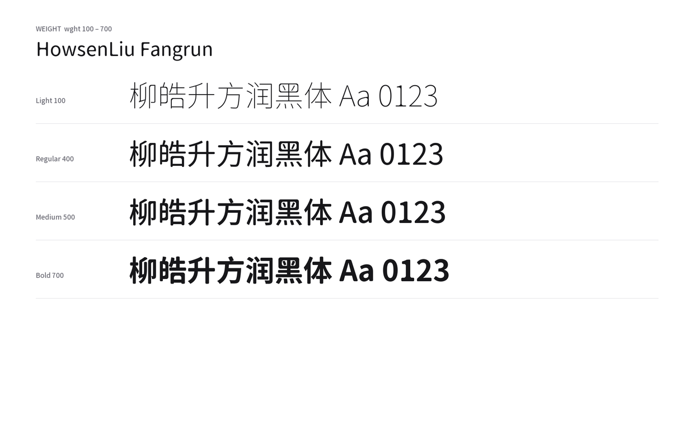
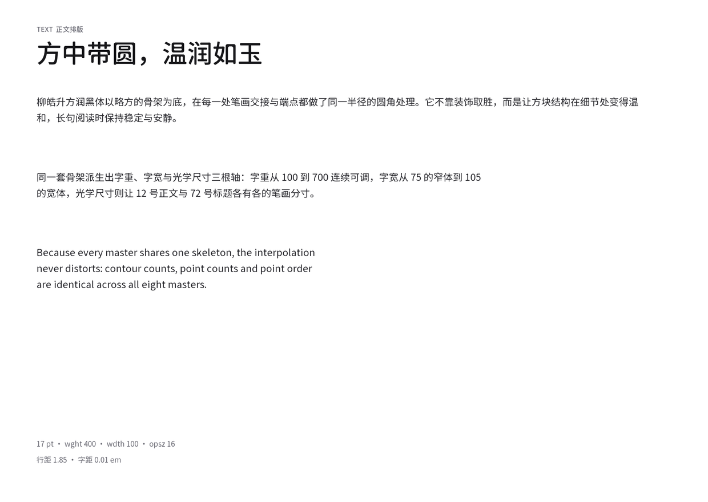

<div align="center">

# 柳皓升方润黑体 · HowsenLiu Fangrun

**方正骨架，圆润收口 —— 一款为屏幕与印刷打磨的中文无衬线字体。**

[](https://github.com/HowsenLiu/HowsenLiuFangrun/releases/latest)
[](LICENSE)
[](#简介)

[English](README.md) · [字体官网](https://howsenliufangrun.pages.dev) · [GitHub](https://github.com/HowsenLiu/HowsenLiuFangrun)

</div>


<table>
<tr>
<td width="62%" valign="top">

## 简介

**柳皓升方润黑体（HowsenLiu Fangrun）** 以略方的建筑感骨架为底，
在每一处笔画交接与端点做同一半径的圆角处理：结构方正，细节柔和，
阅读干净，标题醒目。

由 **柳皓升（Howsen Liu）** 设计出品。

## 特点

- **统一圆角**：全部笔画转角与端点采用同一圆角半径，风格一致。
- **大字符覆盖**：33,128 字形 / 33,225 码位，覆盖 GBK 全集、
  GB18030 一级、Big5 繁体、假名注音、拉丁 / 希腊 / 西里尔与常用符号。
- **多字重配套**：可变字重 100–700；另附 Light / Regular /
  Medium / Bold 四款静态字重与网页 WOFF2 版本。
- **免费可用**：个人项目与商业项目均可免费使用。

## 安装

**Windows** — 选中 `.ttf` 文件 → 右键 → *安装*。
**macOS** — 双击字体文件 → *安装字体*。
**Linux**

```bash
mkdir -p ~/.local/share/fonts
cp fonts/ttf/*.ttf ~/.local/share/fonts
fc-cache -f -v
```

不支持可变轴的旧版 WPS / 老软件，可在 Release 中下载 TTC 集合包，
一次装入四款静态字重。

## 网页嵌入

```css
@font-face {
  font-family: "HowsenLiu Fangrun";
  src: url("fonts/webfonts/HowsenLiuFangrun-VF-subset.woff2") format("woff2");
  font-weight: 100 700;
  font-display: swap;
}

body { font-family: "HowsenLiu Fangrun", sans-serif; }
```

全字符集 WOFF2 体积较大，随 Release 附件分发；线上页面建议使用
仓库内的 GB2312 常用子集，或按文案自行二次子集化。

## 授权

- **允许**：个人使用与商业使用，嵌入网页、文档、包装、界面与售卖产品。
- **禁止**：修改字体文件与技术参数、提取轮廓制作衍生字体、
  单独再分发或转售、用于 AI 模型训练；仅作者本人可修改源码与字体文件。
- 完整条款见 [LICENSE](LICENSE)；原始骨架署名（Noto / Adobe）按要求保留。

</td>
<td width="38%" valign="top">

### ⬇️ 下载

| 版本 | 格式 · 体积 | 下载 |
|---|---|---|
| 可变字体 | `.ttf` · 140.0 MB | [获取](https://github.com/HowsenLiu/HowsenLiuFangrun/releases/latest/download/HowsenLiuFangrun-VF.ttf) |
| 静态字重包 | `.zip` · 47.7 MB | [获取](https://github.com/HowsenLiu/HowsenLiuFangrun/releases/latest/download/HowsenLiuFangrun-Static-TTF.zip) |
| 静态集合包 | `.ttc` · 114.5 MB | [获取](https://github.com/HowsenLiu/HowsenLiuFangrun/releases/latest/download/HowsenLiuFangrun-TTC.ttc) |
| 网页字体包 | `.zip` · 65.7 MB | [获取](https://github.com/HowsenLiu/HowsenLiuFangrun/releases/latest/download/HowsenLiuFangrun-WOFF2.zip) |
| 可变完整包 | `.zip` · 124.2 MB | [获取](https://github.com/HowsenLiu/HowsenLiuFangrun/releases/latest/download/HowsenLiuFangrun-VF.zip) |
| 集合压缩包 | `.zip` · 47.2 MB | [获取](https://github.com/HowsenLiu/HowsenLiuFangrun/releases/latest/download/HowsenLiuFangrun-TTC.zip) |

### 🌐 网站

- [字体官网](https://howsenliufangrun.pages.dev)
- [作者 GitHub](https://github.com/HowsenLiu)
- [X / Twitter](https://x.com/HowsenLiu_)

</td>
</tr>
</table>

## 样张

<p align="center">


</p>
<p align="center">


</p>

---

<div align="center">

设计：**柳皓升 Howsen Liu** · 版本 2.000 · [变更记录](CHANGELOG.md)

</div>
